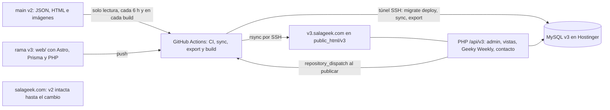

# Sala Geek v3: rediseño en Astro + Prisma sobre Hostinger Premium

> Para agentes: este documento es a la vez el spec y el plan maestro. Ejecútalo fase por fase con superpowers:subagent-driven-development (recomendado) o superpowers:executing-plans. Antes de cada fase de Grok, conviértela en tareas TDD con superpowers:writing-plans en `docs/superpowers/plans/v3-fase-N.md`, sin cambiar los nombres ni los contratos que fija este documento.

**Objetivo:** publicar una v3 de salageek.com con identidad visual nueva, contenido en MySQL gestionado con Prisma y despliegue automático desde GitHub a Hostinger, sin borrar nada de la v2.

**Arquitectura:** GitHub Actions compila el sitio estático con Astro. Prisma copia los JSON de la v2 a una MySQL nueva y exporta un snapshot que Astro convierte en páginas. En Hostinger solo corre lo que necesita servidor: una API PHP en `/api/v3/` para el admin, las vistas, Geeky Weekly y el contacto. Esa API escribe en MySQL y, al publicar, pide una recompilación. La v3 vive en `v3.salageek.com` hasta que apruebes el cambio de dominio.

**Stack:** Astro 7.3.x, TypeScript, Prisma ORM 7.10.0 con `@prisma/adapter-mariadb`, MySQL/MariaDB de Hostinger, PHP 8.3 sin dependencias, Preact y Tiptap solo en el admin, Vitest, Playwright con axe, GitHub Actions con SSH y rsync, Node 24.

## Restricciones globales

- **Next.js queda fuera.** Premium no corre Node.js en el servidor, así que la v3 es Astro estático, como indicaste.
- **Prisma va fijo en 7.10.0** (`prisma`, `@prisma/client` y `@prisma/adapter-mariadb`). Prisma 8 sigue en release candidate y no tiene paquete para MySQL. Por eso `npx prisma@latest` está prohibido.
- **Astro 7.3.x** con `output: 'static'`, `build.format: 'preserve'` y `trailingSlash: 'ignore'`. Node 24 en local y en CI.
- **Las URLs son idénticas a las de la v2** (ver Contratos). Las canónicas, el OG y el sitemap usan siempre `https://salageek.com`, también en staging.
- **Copy:** español, voz activa, sin cifras ni superlativos no confirmados ([PRODUCT.md](PRODUCT.md)).
- **Staging:** lleva `noindex`, no muestra anuncios ni analítica, y Geeky Weekly corre en modo prueba (valida, pero no suscribe a nadie).

## Decisiones confirmadas

- **Hosting:** Premium Web Hosting; la v3 se construye con Astro.
- **Contenido:**
  - Vive en una MySQL nueva con Prisma.
  - Hasta el cambio de dominio, los JSON de la v2 se copian sin modificarse.
  - Después, MySQL pasa a ser la fuente y los JSON quedan congelados como respaldo.
- **Home:** abre con lo más reciente, y Geeky Weekly es la segunda acción.
- **Convivencia en el repo:**
  - Mismo repo, con tag `v2.0.0-checkpoint` y rama congelada `legacy/v2`.
  - La v3 vive en la rama `v3`, dentro de la carpeta `web/`.
  - No se borra nada.
- **Alcance:** la v3 queda completa en `v3.salageek.com` y el cambio de salageek.com queda listo, pero solo corre con tu aprobación en GitHub.
- **Dirección visual:** la corre Claude contigo, comp-first según `buildPath: comp` en [.impeccable/config.json](.impeccable/config.json). Grok construye contra el comp aprobado.
- **Funciones:** todo pasa a la v3 excepto la PWA y HubSpot.
- **Logo:** `SalaGeek_LOGO.webp` e `Icono_SG.ico` se conservan tal cual, y la nueva identidad se construye alrededor.
- **Git:**
  - Los 6 commits locales suben a main.
  - Los cambios a medio hacer (templates movidos, `.gitignore`, README) van a una rama aparte.
  - El checkpoint se crea sobre main ya sincronizado.

## Lo que nunca se borra

- **Git y GitHub:**
  - Nada de force-push, borrar ramas o tags, ni reescribir historia.
  - Los archivos de la v2 en la raíz del repo son de solo lectura para la v3.
  - Las Discussions que usa Giscus no se tocan.
- **Hostinger:**
  - El `public_html` de salageek.com no se toca hasta el cambio de dominio.
  - El sitio nunca se elimina en hPanel.
  - `blog/data/views.json` de producción solo se lee.
  - Hay respaldo antes del cambio, y en producción el rsync corre sin `--delete`.
- **Datos de la v2:**
  - `blog/data/*.json`, `blog/articulos/*.html` y `src/images/**` se leen y nunca se escriben.
  - La audiencia de Mailchimp solo recibe altas.
- **MySQL v3:**
  - Una guardia en CI rechaza migraciones destructivas.
  - Contra Hostinger están prohibidos `prisma migrate reset`, `prisma db push` y `prisma migrate dev`. Solo se permite `prisma migrate deploy`.

## Arquitectura



Mientras dura el staging, la v2 sigue siendo la fuente: [api/save-article.php](api/save-article.php) publica en main por la API de GitHub, y la v3 copia esos datos. Tras el cambio de dominio, la sincronización se apaga con `LEGACY_SYNC_ENABLED=false`.

## Estructura en la rama v3

```
web/
  package.json, package-lock.json, .nvmrc (24), astro.config.mjs, tsconfig.json, prisma7.config.ts
  prisma/schema.prisma, prisma/migrations/
  src/content.config.ts            colecciones desde .content/snapshot.json
  src/lib/content/                 types.ts y queries.ts sobre el snapshot
  src/layouts/BaseLayout.astro     incluye <meta name="sg-build" content="<git sha>">
  src/pages/index.astro, blog/index.astro, blog/articulos/[slug].astro
  src/pages/media-kit.astro, privacidad.astro, terminos.astro, cookies.astro, 404.astro
  src/pages/admin/index.astro      shell estático del admin
  src/pages/sitemap.xml.ts, robots.txt.ts, search-index.json.ts
  src/scripts/                     consent, ads, analytics, views, search, blog-filter, share, reading-progress, easter-eggs/
  src/admin/                       app Preact + Tiptap
  php/api/v3/                      se publica como /api/v3/
  public/                          ads.txt, google3b1f79a21afa0693.html, .well-known/security.txt, sw.js, fuentes woff2
  scripts/                         sync-legacy.ts, legacy/, export-content.ts, copy-legacy-assets.ts, check-migrations.ts,
                                   render-htaccess.ts, seed-admin.ts, db-ping.ts, capture.ts, smoke.ts
  tests/                           unit/, api/, e2e/, fixtures/ (los 6 artículos reales)
.github/workflows/v3-ci.yml, v3-deploy.yml
docs/superpowers/plans/2026-10-12-sala-geek-v3.md, docs/v3/cutover-runbook.md
```

Hay que sumar estas líneas a `.gitignore` en v3: `.impeccable/config.local.json`, `.impeccable/review/`, `agent-transcripts/`, `.cmem-projects/`, `web/node_modules/`, `web/dist/`, `web/.env*`, `web/.content/`, `web/public/src/images/` y `web/src/generated/`.

## Contratos

### URLs (las mismas de la v2)

- `/` genera `index.html`.
- `/blog/` genera `blog/index.html`; mantiene `?categoria=peliculas|series|anime|gaming|tecnologia`.
- `/blog/articulos/<slug>` genera `blog/articulos/<slug>.html`. La canónica va sin `.html`, y Giscus mapea por pathname.
- `/media-kit`, `/privacidad`, `/terminos` y `/cookies` generan `<nombre>.html`. `/admin` genera `admin/index.html`.
- `/src/images/...` conserva la misma ruta para portadas, logo e ícono: `copy-legacy-assets.ts` los copia desde main antes del build.
- `/sitemap.xml`, `/robots.txt`, `/ads.txt`, `/google3b1f79a21afa0693.html`, `/.well-known/security.txt` y `/404.html`.
- `render-htaccess.ts` genera el `.htaccess`:
  - Mismas reescrituras de [.htaccess](.htaccess): `^blog/articulos/([^/]+)$` a `$1.html`, las páginas bonitas y `/admin`.
  - En producción agrega además las reglas de www a apex y de HTTP a HTTPS.
  - Siempre bloquea:
    - los archivos que empiezan con `_` en `/api/v3/`
    - los nombres de la API v2 (`auth`, `save-article`, `upload-image`, `list-images`, `get-drafts`, `track-view`, `mailchimp-subscribe` y `contact-form`)
  - En staging devuelve 404 si el host no es `v3.salageek.com`.
  - Define todas sus cabeceras (CSP sin HubSpot, nosniff, referrer y cache), porque el `.htaccess` de `public_html` también aplica a la subcarpeta.

### Modelo de datos (Prisma 7, MySQL)

```prisma
generator client {
  provider = "prisma-client"
  output   = "../src/generated/prisma"
}

datasource db {
  provider = "mysql"
}

enum ArticleStatus {
  DRAFT
  PUBLISHED
}

model Category {
  id        String    @id @db.VarChar(20)
  name      String    @db.VarChar(40)
  sortOrder Int       @map("sort_order")
  articles  Article[]
  @@map("categories")
}

model Author {
  id       Int       @id @default(autoincrement())
  name     String    @unique @db.VarChar(80)
  slug     String    @unique @db.VarChar(80)
  articles Article[]
  @@map("authors")
}

model Article {
  id              String        @id @db.VarChar(32)
  slug            String        @unique @db.VarChar(80)
  title           String        @db.VarChar(200)
  excerpt         String        @db.Text
  bodyHtml        String        @map("body_html") @db.MediumText
  coverImage      String?       @map("cover_image") @db.VarChar(255)
  ogImage         String?       @map("og_image") @db.VarChar(255)
  categoryId      String        @map("category_id") @db.VarChar(20)
  category        Category      @relation(fields: [categoryId], references: [id])
  authorId        Int           @map("author_id")
  author          Author        @relation(fields: [authorId], references: [id])
  status          ArticleStatus @default(DRAFT)
  featured        Boolean       @default(false)
  trending        Boolean       @default(false)
  readMinutes     Int           @map("read_minutes")
  metaDescription String?       @map("meta_description") @db.VarChar(320)
  metaKeywords    String?       @map("meta_keywords") @db.VarChar(500)
  canonicalUrl    String?       @map("canonical_url") @db.VarChar(255)
  noIndex         Boolean       @default(false) @map("no_index")
  publishedAt     DateTime?     @map("published_at")
  modifiedAt      DateTime?     @map("modified_at")
  createdAt       DateTime      @default(now()) @map("created_at")
  updatedAt       DateTime      @updatedAt @map("updated_at")
  deletedAt       DateTime?     @map("deleted_at")
  legacySource    String?       @map("legacy_source") @db.VarChar(20)
  tags            ArticleTag[]
  views           ArticleViews?
  @@index([status, publishedAt])
  @@index([categoryId])
  @@map("articles")
}

model Tag {
  id       Int          @id @default(autoincrement())
  slug     String       @unique @db.VarChar(80)
  name     String       @db.VarChar(80)
  articles ArticleTag[]
  @@map("tags")
}

model ArticleTag {
  articleId String  @map("article_id") @db.VarChar(32)
  tagId     Int     @map("tag_id")
  article   Article @relation(fields: [articleId], references: [id])
  tag       Tag     @relation(fields: [tagId], references: [id])
  @@id([articleId, tagId])
  @@map("article_tags")
}

model ArticleViews {
  articleId String   @id @map("article_id") @db.VarChar(32)
  count     Int      @default(0)
  updatedAt DateTime @updatedAt @map("updated_at")
  article   Article  @relation(fields: [articleId], references: [id])
  @@map("article_views")
}

model Media {
  id        Int      @id @default(autoincrement())
  path      String   @unique @db.VarChar(255)
  mime      String   @db.VarChar(40)
  width     Int?
  height    Int?
  bytes     Int?
  alt       String?  @db.VarChar(255)
  legacy    Boolean  @default(false)
  createdAt DateTime @default(now()) @map("created_at")
  @@map("media")
}

model AdminUser {
  id           Int       @id @default(autoincrement())
  email        String    @unique @db.VarChar(190)
  name         String    @db.VarChar(80)
  passwordHash String    @map("password_hash") @db.VarChar(255)
  lastLoginAt  DateTime? @map("last_login_at")
  createdAt    DateTime  @default(now()) @map("created_at")
  updatedAt    DateTime  @updatedAt @map("updated_at")
  @@map("admin_users")
}

model RateLimit {
  key         String   @id @db.VarChar(190)
  windowStart DateTime @map("window_start")
  hits        Int
  @@map("rate_limits")
}

model AuditLog {
  id       Int      @id @default(autoincrement())
  actor    String   @db.VarChar(190)
  action   String   @db.VarChar(40)
  entity   String   @db.VarChar(40)
  entityId String   @map("entity_id") @db.VarChar(64)
  detail   String?  @db.Text
  at       DateTime @default(now())
  @@map("audit_log")
}

model SyncRun {
  id               Int       @id @default(autoincrement())
  sourceCommit     String    @map("source_commit") @db.VarChar(40)
  startedAt        DateTime  @default(now()) @map("started_at")
  finishedAt       DateTime? @map("finished_at")
  articlesUpserted Int       @default(0) @map("articles_upserted")
  viewsMerged      Int       @default(0) @map("views_merged")
  @@map("sync_runs")
}
```

Los nombres de tablas y columnas van explícitos en snake_case porque PHP los escribe a mano en SQL, y porque así lo pide Prisma 8 para una migración futura. En la conexión, PHP usa `localhost` y Node usa `127.0.0.1` (documentación de Hostinger).

**Mapeo de la v2 en `sync-legacy.ts`** (siempre con upsert, transacción por artículo y modo `--dry-run`):

- **Campos que se copian igual:** `id`, `slug`, `title`, `excerpt`, `featured`, `trending`, `metaDescription`, `metaKeywords`, `ogImage` y `noIndex`.
- **Cuerpo del artículo:** sale de `.article-content` del HTML del artículo. Si no aparece o viene vacío, la sincronización falla; nunca se importa un cuerpo vacío.
- **Taxonomía:** `category` va a `categoryId`, validado contra las 5 categorías. `tags` va a la tabla Tag, ignorando el elemento de categoría que trae `categories`.
- **Autor:** `author` va a Author por nombre.
- **Fechas y lectura:** `publishDate` va a `publishedAt` y `modifiedDate` a `modifiedAt`. `readTime` ("5 min") se convierte en `readMinutes` (5).
- **Estado:** `status` pasa de "published" a PUBLISHED, y los artículos de `drafts.json` entran como DRAFT.
- **Otros campos:** `image` va a `coverImage` (misma ruta) y `canonicalUrl` vacío se guarda como null.
- **Texto:** `repairMojibake()` corrige casos como `ficci├│n` y `ó`.
- **Vistas:** `views.json` va a ArticleViews tomando siempre el máximo, para no perder conteos.
- **Garantía de solo lectura:** el hash de los archivos fuente debe ser idéntico antes y después.

### Snapshot que lee Astro (`.content/snapshot.json`, generado por `export-content.ts`)

```ts
export type CategoryId = 'peliculas' | 'series' | 'anime' | 'gaming' | 'tecnologia';
export interface ArticleSnapshot {
  id: string; slug: string; title: string; excerpt: string; bodyHtml: string;
  coverImage: string | null; ogImage: string | null;
  category: { id: CategoryId; name: string };
  author: { name: string; slug: string };
  tags: { slug: string; name: string }[];
  featured: boolean; trending: boolean; readMinutes: number;
  metaDescription: string | null; metaKeywords: string | null;
  canonicalUrl: string | null; noIndex: boolean;
  publishedAt: string; modifiedAt: string | null;
}
export interface ContentSnapshot {
  generatedAt: string; sourceCommit: string | null;
  categories: { id: CategoryId; name: string; sortOrder: number }[];
  articles: ArticleSnapshot[]; // solo PUBLISHED, sin deletedAt, ordenados por publishedAt desc
}
```

Las consultas viven en `src/lib/content/queries.ts`:

- `getPublishedArticles()`
- `getArticleBySlug(slug)`
- `getFeaturedArticles(limit = 3)`
- `getLatestArticles(limit)`
- `getRelatedArticles(article, limit = 3)`: misma categoría, sin incluirse a sí mismo, las más nuevas primero.

En local, `CONTENT_SOURCE=fixtures` usa `tests/fixtures/snapshot.json`, así que no hace falta base de datos. El cuerpo se sanea con `sanitize-html` al compilar. La lista blanca de iframes solo admite YouTube.

### API PHP v3 (`/api/v3/`, JSON, mismo origen)

- **`auth.php`:**
  - `POST ?action=login` recibe `{email, password}` y devuelve `{user, csrfToken}`.
  - `POST ?action=logout` cierra la sesión. `GET ?action=me` devuelve `{user, csrfToken}`, o 401 sin sesión.
  - `POST ?action=change-password` guarda la contraseña nueva en `admin_users`; en la v2 no se guardaba.
  - La cookie se llama `sg_admin_v3` (Secure, HttpOnly, SameSite=Strict, 24 h). Hay un límite de 5 intentos cada 5 minutos por IP.
- **`articles.php`** (admin; las escrituras requieren `X-CSRF-Token`):
  - Rutas: `GET` (lista con status, q y page, o `?id=`), `POST` (crear), `PUT ?id=` (actualizar), `POST ?action=publish|unpublish&id=` y `DELETE ?id=`.
  - `DELETE` es un borrado lógico (`deleted_at`).
  - Todo cambio visible pide una recompilación.
- **`media.php`** (admin):
  - `POST` recibe archivos jpeg, png, webp o gif de hasta 8 MB.
  - Los convierte a WebP en 480, 960 y 1600 px sin agrandar, y los guarda en `/uploads/AAAA/MM/`.
  - `GET` devuelve la lista paginada.
- **`views.php`:** `POST {slug}` suma una vez por cookie `sg_views` de 24 h, igual que [api/track-view.php](api/track-view.php). `GET ?slug=` devuelve `{count}`.
- **`subscribe.php`:**
  - Recibe `POST {email, recaptchaToken}` y valida con reCAPTCHA v3 (puntaje mínimo 0.5).
  - Suscribe en Mailchimp con las mismas etiquetas de la v2 (`Website Subscriber`, `Newsletter`, `SOURCE=Website`).
  - En staging corre con `dryRun`.
- **`contact.php`:**
  - Mismos campos y servicios que [api/contact-form.php](api/contact-form.php), con el honeypot `bot-field` y un límite de 5 envíos cada 5 minutos.
  - Envía con `mail()`; en staging el asunto lleva `[STAGING]`.
- **`rebuild.php`** (admin): pide una recompilación manual.
- **`_github.php`:**
  - Hace `POST /repos/HumbertMarin09/SalaGeek_Landing/dispatches` con `event_type: content-published` y `client_payload.env`.
  - Si hay varias publicaciones seguidas, el `concurrency` del workflow las encola en una sola recompilación.

### Configuración en el servidor

- **`~/sg-config/v3-<env>.json`:** vive fuera de `public_html` con permisos 600.
  - Contiene la BD (host `localhost`), las llaves de Mailchimp y reCAPTCHA, el token de dispatch, `CONTACT_EMAIL` y las banderas `dryRun`.
  - Lo escribe el deploy en cada corrida a partir de los secrets del environment de GitHub, así que nadie lo edita a mano.
- **`api/v3/_env.php`:** lo genera CI y no lleva secretos; solo indica el entorno y la ruta de ese JSON.

## Dirección visual (Fase 1, Claude contigo)

Aquí `impeccable` equivale a `.agents/skills/impeccable/scripts/impeccable.cmd`.

### Proceso

1. Correr `impeccable context --target web/src/pages/index.astro` y seguir el flujo de rediseño de `reference/new-work.md`. El look actual es evidencia y anti-referencia.
2. Correr `impeccable concept-seed --scope direction --mode persuade` y presentar las direcciones con `impeccable serve-question`. Cada carta lleva su comp generado.
   - Cada carta también trae (regla de frontend-design):
     - una paleta de 4 a 6 colores en hex con nombre
     - los roles tipográficos
     - el layout con un wireframe ASCII
     - los principios
   - Antes de bloquear una dirección, se revisa contra los defaults genéricos y se corrige lo que se parezca a la plantilla de la categoría.
3. Elegida la dirección, escribir el contrato de dirección en el surface brief con `impeccable surface-brief write web/src/pages/index.astro <archivo>`. Lleva los bloques THESIS, OWN-WORLD, STORY, FIRST VIEWPORT, FORM con la seed key, y FINISH.
4. Ronda de comps según `reference/visualize.md`: tres composiciones de la home, y la que elijas queda con `"approved": true` en su sidecar.
5. Rondas de superficie code-led para `web/src/pages/blog/articulos/[slug].astro` y `web/src/pages/blog/index.astro`, con `concept-seed --scope surface --mode read` y bocetos HTML.
6. Entregables para Grok, todos commiteados en v3:
   - la seed key
   - los surface briefs
   - la ruta del comp aprobado
   - las referencias del QUALITY BAR

### Material de partida para la tirada

- **Mecanismo:** cobertura diaria y gratuita en español de cine, series, anime y videojuegos, más Geeky Weekly cada semana. El sitio guarda secretos (easter eggs y logros) para quien explora.
- **Escena (hipótesis a confirmar en la ronda):** llegan desde una publicación en redes directo a un artículo, casi siempre en el teléfono, y luego pasan a la home a ver qué más salió hoy.
- **El molde que se evita:**
  - La "portada gamer": azul marino casi negro, dorado o neón con resplandor, vidrio esmerilado y partículas. Es el look actual (`#0a0e27`, `#ffd166`, header con blur).
  - El clon de portal grande: retícula blanca de miniaturas con acento rojo.
  - Su opuesto predecible: periódico crema con serif.
- **Siete candidatos.** Son referencias de sistema, no de marca: nada de logos, personajes ni tipografías propietarias.
  1. Álbum de estampas mundialista: cada nota es una estampa numerada con la franja de color de su categoría, y los logros llenan el álbum.
  2. Revista semanal de manga: secciones en papel de color, tramas de puntos y un ranking semanal; Geeky Weekly funciona como el número de la semana. Sin rayos tipo sol naciente.
  3. Revista latinoamericana de videojuegos de los 90: portada con titulares, recuadros de calificación y una sección de trucos y secretos donde viven los easter eggs.
  4. Guía de programación de TV: la cobertura del día como parrilla por canales (Cine, Series, Anime, Videojuegos).
  5. Rotulación popular de los puestos geek de la Ciudad de México: letreros pintados a mano, colores de plástico y etiquetas de precio. Riesgo: que no se lea como algo de todo el mundo hispano.
  6. Videoclub de barrio: repisas por género, pared de estrenos y tarjeta de socio.
  7. Marquesina de cine: la lectura literal de "Sala", con letras intercambiables y boletos. Es el único candidato literal.

### Reglas que hereda Grok

- Leer `reference/craft-floor.md` antes de cualquier edición de UI.
- Las fuentes se sirven desde el propio sitio en woff2 con `@font-face`, nada de Google Fonts. En las superficies Persuade quedan vetadas las fuentes que Impeccable lista como default (Fraunces, Playfair, Space Grotesk, Inter como display, DM Sans, Outfit, Plus Jakarta, Instrument Sans y similares).
- Evitar estos recursos:
  - destacar una sola palabra del titular con otro color o itálica
  - etiquetas en mayúsculas sobre cada sección
  - numeración decorativa cuando el contenido no es una secuencia
  - una flecha "→" pegada al texto de los botones
  - animaciones de entrada en cada sección: hay un solo momento de movimiento orquestado
- El logo se usa intacto: sin recolorear, sin deformar y sin efectos alrededor.
- Contraste AA, foco visible, objetivos táctiles de al menos 44 px y `prefers-reduced-motion` también en los easter eggs.
- Nada de símbolos cargados como decoración.
- El copy de los comps se copia literal. Cualquier cambio a un texto factual se te consulta.

## Paridad funcional

- **Home:**
  - Destacadas y últimas noticias primero, Geeky Weekly en segundo lugar, y las categorías.
  - "Acerca de" conserva "desde 2017", sin las cifras no confirmadas.
  - Las redes aparecen sin conteos de seguidores, y luego el footer.
  - Se arreglan los enlaces muertos `#newsletter`, `#weekly-news` y `#contacto`.
- **Blog:**
  - Filtros con `?categoria=` y carrusel de destacadas.
  - Retícula paginada de 6 por página (4 en pantallas de 480 px o menos), y la suscripción.
- **Artículo:**
  - Migas, categoría, fecha, título, extracto, "Por" con el autor, minutos de lectura, vistas, portada y cuerpo.
  - Compartir en X, Facebook y WhatsApp, más copiar enlace.
  - Etiquetas, "También te puede interesar" (3 de la misma categoría) y barra de progreso de lectura.
  - Giscus con el mismo repo, la categoría Announcements, mapeo por `pathname` y idioma `es`.
- **Búsqueda:** global en el header, sobre un índice generado al compilar.
- **Media kit:** servicios y formulario de contacto, sin métricas no confirmadas. **Legales:** se migran privacidad, términos y cookies, y la política de cookies ya no menciona HubSpot ni la PWA. **404:** página propia.
- **Consentimiento:** mismas categorías y misma cookie `sg_cookie_consent`, con el formato de [src/js/cookie-consent.js](src/js/cookie-consent.js).
- **Terceros:**
  - AdSense `ca-pub-3884162231581435` con los slots de [src/js/monetization.js](src/js/monetization.js), y `ads.txt` idéntico.
  - GTM `GTM-WBJXS2PX` y GA4.
  - Todos cargan solo con consentimiento y están apagados en staging.
  - Se conservan la verificación de Search Console, reCAPTCHA v3 y `security.txt` (con su enlace corregido a `/media-kit#contacto`).
- **Easter eggs:**
  - Los 9 con seguimiento y los que no se rastrean (3:33 AM y temas por fecha).
  - Los sonidos 8-bit suenan solo tras un gesto del usuario.
  - Mismos disparadores de [src/js/script.js](src/js/script.js), misma clave `easterEggProgress` y mismos niveles; los visuales se rehacen en el mundo nuevo.
- **Admin:**
  - Login, panel con estadísticas, recientes, borradores, actividad (desde `audit_log`), publicaciones por mes, categorías y salud SEO.
  - Lista de artículos con búsqueda y filtros.
  - Editor Tiptap con StarterKit, Underline, TextAlign, Link, imagen con anchos de 25, 50, 75 y 100 %, rejilla de 1 a 4 columnas y YouTube.
  - Biblioteca de medios.
  - SEO: semáforos de 50–60, 100–200 y 150–160 caracteres, vista previa de Google, 6 chequeos, canónica, imagen OG y noindex.
  - Vista previa en escritorio, tablet y móvil; conteo de palabras y minutos de lectura automáticos (200 palabras por minuto).
  - Autor, categoría, etiquetas, destacada y trending.
  - Autoguardado local con la clave `admin_draft_article` y cambio de contraseña que sí se guarda.
- **Se retiran:**
  - La PWA: se quita el manifest y se publica un `/sw.js` que se desregistra y borra las cachés de quienes ya la tienen instalada.
  - HubSpot: se quitan el script y su entrada en la CSP.
- **Fuera de alcance:** las plantillas de correo y newsletter (viven en Mailchimp), `assets/social-card-generator.html` y `assets/mediakit-print.html`.

```js
// web/public/sw.js — desregistra la PWA de la v2 (servir con Cache-Control: no-cache)
self.addEventListener('install', () => self.skipWaiting());
self.addEventListener('activate', (event) => {
  event.waitUntil((async () => {
    const keys = await caches.keys();
    await Promise.all(keys.map((key) => caches.delete(key)));
    await self.registration.unregister();
    const clients = await self.clients.matchAll({ type: 'window' });
    clients.forEach((client) => client.navigate(client.url));
  })());
});
```

## Fases

Las Fases 1 y 2 pueden correr en paralelo.

### Fase 0: checkpoint y preparación (Claude contigo)

1. Confirmar en hPanel, en Avanzado → GIT, que no haya auto-deploy desde main. Si existe, nada se sube sin tu OK.
2. Ejecutar la secuencia de Git (sin rebase ni reset):

```powershell
git fetch origin --tags
git switch -c wip/plantillas-templates
git add .gitignore README.md
git commit -m "wip: mover plantillas a templates/ y ajustar .gitignore y README"
git push -u origin wip/plantillas-templates
git switch main
git merge origin/main
git push origin main
git tag -a v2.0.0-checkpoint -m "Checkpoint de la v2 antes de la v3 (2026-10-12)"
git push origin v2.0.0-checkpoint
git branch legacy/v2 v2.0.0-checkpoint
git push -u origin legacy/v2
git switch -c v3
```

`git merge origin/main` hace falta solo si main está detrás. Los renombres de los templates ya están en el índice, por eso solo se agregan `.gitignore` y README.

3. Preparar la rama v3:
   - Commitear PRODUCT.md, `.impeccable/config.json`, `.impeccable/live/config.json`, `.agents/skills/`, `.cursor/skills/`, `.cursor/agents/`, `.cursor/hooks.json`, `.codex/hooks.json`, `skills-lock.json`, las líneas nuevas de `.gitignore` y este plan.
   - Actualizar PRODUCT.md: el logo conservado pasa a compromisos de marca; la PWA y HubSpot salen de las capacidades; el stack de la v3 queda anotado.
   - Hacer push de v3.
4. Crear un ruleset en GitHub que impida borrar o hacer force-push sobre main, `legacy/v2` y los tags `v2*`. No exige PR en main, porque el admin v2 escribe ahí.
5. Checkpoint en Hostinger:
   - Generar un respaldo manual en hPanel.
   - Crear `tar -czf ~/backups/salageek-v2-2026-10-12.tar.gz -C ~/domains/salageek.com public_html` por SSH (ruta exacta según hPanel).
   - Descargar una copia con `scp -P 65002`.
6. Hacer las acciones manuales de la lista de abajo.
   - Claude genera la llave `sg-ci` (ed25519).
   - Se prueba `ssh -p 65002 <usuario>@<host> "echo ok && mysql --version"`.
7. Guardar este plan en `docs/superpowers/plans/2026-10-12-sala-geek-v3.md` y en claude-mem (sección propia abajo).
8. Opcional, con tu OK: usar find-skills (`npx skills find astro`, `npx skills find github actions`) e instalar solo de fuentes oficiales con al menos 1K instalaciones. No instalar skills de Prisma que asuman Prisma 8.

**Verificación:**

- `git ls-remote origin` muestra `v2.0.0-checkpoint`, `legacy/v2`, `v3` y `wip/plantillas-templates`.
- `git status` queda limpio en v3.
- El respaldo existe y pesa más de 0 bytes.
- claude-mem responde `success: True`.

### Fase 1: dirección visual (Claude contigo)

Se sigue el proceso de la sección Dirección visual. **Resultado:** dirección bloqueada, comp de la home aprobado y bocetos del artículo y del blog bloqueados, todo commiteado en v3.

### Fase 2: esqueleto, CI y staging de punta a punta (Grok)

- Crear `web/` con:
  - Astro 7.3.x, TS estricto, `@astrojs/preact`, Vitest, Playwright y ESLint con Prettier.
  - `.nvmrc` en 24.
  - Los scripts `dev`, `build` (que corre `assets:legacy` y luego `astro build`), `verify`, `test`, `test:api`, `test:e2e`, `capture`, `smoke`, `db:guard`, `sync:legacy`, `content:export`, `assets:legacy`, `render:htaccess` y `db:seed:admin`.
- Configurar `astro.config.mjs` con `site` desde `SITE_URL` y los valores de Restricciones globales. Crear una página mínima para cada URL del contrato.
- Escribir `render-htaccess.ts` con sus pruebas: guardia de host en staging, bloqueo de la API v2 y de los archivos `_`, y reescrituras.
- Escribir `copy-legacy-assets.ts` con su prueba de que la fuente no cambia. Agregar `public/sw.js` y los archivos estáticos.
- Cambiar `.impeccable/live/config.json` para que apunte a `web/src/layouts/BaseLayout.astro`.
- `v3-ci.yml` corre en push y PR a v3: lint, typecheck, pruebas unitarias y build con fixtures.
- `v3-deploy.yml` (solo staging) corre después de CI:

```yaml
env:
  HOST: ${{ secrets.HOSTINGER_SSH_HOST }}
  PORT: ${{ secrets.HOSTINGER_SSH_PORT }}
  USER: ${{ secrets.HOSTINGER_SSH_USER }}
  DEPLOY_PATH: ${{ secrets.DEPLOY_PATH }}
steps:
  - name: SSH con host fijado
    run: |
      install -d -m 700 ~/.ssh
      printf '%s\n' "${{ secrets.HOSTINGER_SSH_KEY }}" > ~/.ssh/id_ed25519 && chmod 600 ~/.ssh/id_ed25519
      printf '%s\n' "${{ secrets.HOSTINGER_KNOWN_HOSTS }}" > ~/.ssh/known_hosts
  - name: Túnel a MySQL
    run: ssh -fN -o ExitOnForwardFailure=yes -p "$PORT" -L 3307:127.0.0.1:3306 "$USER@$HOST"
  - name: Publicar en staging (el --delete solo vale dentro de public_html/v3)
    run: rsync -az --delete --exclude '/uploads/' -e "ssh -p $PORT" web/dist/ "$USER@$HOST:$DEPLOY_PATH/"
  - name: Smoke
    run: npm --prefix web run smoke -- --base https://v3.salageek.com --env staging
```

- `db-ping.ts` prueba el túnel con `SELECT 1`.
- `smoke.ts` comprueba:
  - Que cada URL del contrato responda 200.
  - Que la cabecera sea `X-Robots-Tag: noindex, nofollow`.
  - Que `sg-build` sea igual al SHA desplegado.
  - Que `/api/save-article.php` y `/api/v3/_env.php` respondan 403.
  - Que `https://salageek.com/v3/` responda 404.

**Verificación:**

- CI y deploy en verde.
- `v3.salageek.com` muestra las páginas mínimas con noindex.
- salageek.com sigue igual: título de la v2 y sin `sg-build`.

### Fase 3: datos (Grok)

- Instalar `prisma`, `@prisma/client` y `@prisma/adapter-mariadb` exactamente en `7.10.0`.
- Crear `prisma7.config.ts` (con `datasource.url = env("DATABASE_URL")`), el schema del contrato y la migración `init`.
- `check-migrations.ts` falla si encuentra `DROP`, `TRUNCATE`, `DELETE FROM`, `ALTER TABLE ... DROP` o `RENAME`. Lleva pruebas.
- Escribir `scripts/legacy/` (`parse.ts` con zod, `extract-body.ts`, `mojibake.ts`, `map.ts`) con pruebas sobre los 6 artículos reales. Escribir `sync-legacy.ts` (idempotente, registra un SyncRun, admite `--dry-run` y `--views <archivo>`).
- `export-content.ts` genera `.content/snapshot.json`. Sobre él se construyen `content.config.ts` y `queries.ts`, con pruebas.
- `seed-admin.ts` (una sola vez) toma `ADMIN_SEED_EMAIL`, `ADMIN_SEED_NAME` y `ADMIN_SEED_PASSWORD_HASH`, que es el hash bcrypt actual tal cual.
- En CI, con un servicio MariaDB de la misma versión que Hostinger: `migrate deploy`, la sincronización dos veces (con conteos iguales) y luego export y build.
- En el deploy, por el túnel:
  1. Guardia y `migrate deploy`.
  2. Sincronización desde `legacy-src/`, que es main en sparse checkout de `blog/data`, `blog/articulos` y `src/images`.
  3. Lectura de `views.json` de producción con `ssh cat`.
  4. Export, build y rsync.

**Verificación:**

- Staging muestra los 6 artículos reales completos.
- Los conteos en MySQL coinciden con los de la v2.
- Una segunda sincronización no hace cambios y `git diff` sobre `legacy-src` queda vacío.

### Fase 4: API PHP v3 (Grok)

- Archivos internos (con prefijo `_`): `_bootstrap.php`, `_db.php` (PDO utf8mb4, excepciones, sin prepares emulados), `_session.php`, `_csrf.php`, `_ratelimit.php`, `_json.php`, `_github.php`, `_mailchimp.php` y `_recaptcha.php`.
- Endpoints del contrato. Todo el SQL va con sentencias preparadas.
- Pruebas en `tests/api/*.test.ts` (Vitest y fetch con cookies) contra `php -S` en CI, con `dryRun` para GitHub y Mailchimp:
  - login correcto, login fallido y límite de intentos
  - CSRF obligatorio
  - crear un borrador, publicar (lo que dispara la recompilación) y borrar lógicamente
  - las vistas suman una sola vez
  - el honeypot del contacto
- `php -l` sobre todos los archivos.

**Verificación:**

- El job de la API pasa en verde.
- En staging, el login funciona y el contador de vistas sube en un artículo real.

### Fase 5: sitio público (Grok)

- **Home comp-led:**
  1. `impeccable context --target web/src/pages/index.astro`, leer `craft-floor.md` y `impeccable build-phase start --comp <comp aprobado> --artifact web/src/pages/index.astro`.
  2. Pasar por los gates spec, plates, hero, sections, motion y responsive, con capturas de `npm run capture`.
- **Blog y artículo:** según los bocetos bloqueados, en code-led. También media kit, legales y 404.
- **Funciones:** toda la paridad funcional, incluidos los módulos de `src/scripts/` y los easter eggs.
- **SEO:**
  - Canónicas y OG/Twitter.
  - JSON-LD de tipo Organization, WebSite, BreadcrumbList, Blog y Article. FAQPage conserva las mismas 4 preguntas, sin superlativos no confirmados.
  - Sitemap generado desde el snapshot y `robots.txt` según el entorno.
- **Banderas de build:** `PUBLIC_ADS_ENABLED` y `PUBLIC_ANALYTICS_ENABLED`, en false en staging.

**Verificación (Playwright y axe):**

- Todas las rutas renderizan, y `?categoria=` filtra.
- La búsqueda encuentra un artículo por su título, y los relacionados son 3 o menos de la misma categoría.
- No sale ninguna petición a Google Ads, Analytics o GTM antes del consentimiento.
- Cero violaciones serias o críticas de axe.
- Paridad de URLs: cada URL de la v2 responde 200 con la misma canónica.
- Lighthouse móvil con `astro preview` en modo producción: Performance de al menos 90, Accesibilidad de al menos 95 y SEO de 100.

### Fase 6: admin v3 (Grok)

- Ronda de superficie Operate contigo (`concept-seed --scope surface --mode operate`), code-led.
- Construir todo lo del admin listado en Paridad. Al publicar, la API dispara la recompilación y el aviso dice: "Publicado. El sitio se actualiza en unos minutos."

**Verificación:**

- Flujo de Playwright en staging: login, borrador, publicar, y la API responde `rebuild: "queued"`.
- Revisión manual de que el artículo aparece tras el deploy.

### Fase 7: automatización completa (Grok)

- `v3-deploy.yml` suma tres disparadores:
  - `repository_dispatch` con el tipo `content-published`
  - `schedule` cada 6 horas, si `vars.LEGACY_SYNC_ENABLED == 'true'`
  - `workflow_dispatch` con target `staging` o `production`; production exige el environment `production` con tu aprobación y además `vars.CUTOVER_APPROVED == 'true'`
- `concurrency` por destino, que encola sin cancelar. Las corridas que solo traen contenido se saltan CI.
- Copiar a main solo los archivos `.github/workflows/v3-*.yml`; nada más cambia en main. GitHub lee de la rama por defecto los workflows de `repository_dispatch`, `schedule` y `workflow_dispatch`.
- CI avisa si esos archivos se desvían de su copia en main. Cada corrida deja un resumen con el SHA, los conteos y las URLs.

**Verificación:** una publicación desde el admin de staging dispara una corrida, y una publicación real de la v2 aparece en staging en 6 horas o menos.

### Fase 8: QA y cierre de diseño (Grok y un revisor nuevo)

- Una ronda de capturas en escritorio (1440) y móvil (390) de home, blog, artículo, media kit y admin, más `impeccable detect --json`.
- Revisor `impeccable-finish-reviewer` en un contexto nuevo, con el paquete de `new-work.md` §7.
- Un solo lote de correcciones y su veredicto.
- El documentador escribe `DESIGN.md` y `.impeccable/design.json`, y se cierra con `impeccable build-phase finish --disposition ship`.
- Pasada completa: lint, typecheck, pruebas, e2e, axe, Lighthouse, enlaces y paridad de URLs.

### Fase 9: cambio de dominio, listo pero bloqueado (Grok lo prepara; corre solo con tu aprobación)

`docs/v3/cutover-runbook.md`:

1. Congelar el admin v2 durante la ventana del cambio.
2. Respaldar: hPanel, `tar` de `public_html` a `~/backups/` con descarga local, y `mysqldump`.
3. Preparar la base de producción:
   - Crear la base de producción.
   - Correr `migrate deploy`.
   - Hacer la sincronización final de artículos y de `views.json` de producción.
   - Cargar el admin con `seed-admin`.
4. Desplegar a `public_html`:
   - Con rsync sin `--delete`, excluyendo `/v3/` y `/uploads/`.
   - Con el `.htaccess` de producción, que bloquea la API v2 aunque sus archivos sigan en disco.
5. Correr el smoke de producción y la paridad de URLs, y reenviar el sitemap en Search Console.
6. Fijar `LEGACY_SYNC_ENABLED=false` y quitar el revisor obligatorio del environment production, para que las publicaciones salgan solas.
7. Vuelta atrás: `tar -xzf ~/backups/<archivo> -C ~/domains/salageek.com` restaura cada archivo sobrescrito, porque nada se borró.
8. Después: PR de `v3` a `main`, sin borrar archivos de la v2.

Antes de pedirte aprobación, el job corre `rsync --dry-run` contra la ruta de producción y lista lo que sobrescribiría. Debe mostrar cero borrados.

## Acciones manuales tuyas

- **hPanel:**
  - Activar el acceso SSH y agregar la llave pública `sg-ci`.
  - Crear el subdominio `v3.salageek.com` con la carpeta `public_html/v3` y SSL.
  - Crear la base `…_sgv3_stg` con su usuario, y anotar la versión con `SELECT VERSION();`.
  - Configurar PHP 8.3 o superior con `pdo_mysql`, `gd` con WebP, `curl`, `mbstring` y `fileinfo`.
  - Generar un respaldo manual.
- **GitHub:**
  - Crear los environments `staging` y `production` (production con tu aprobación obligatoria).
  - Cargar los secrets por environment:
    - SSH: `HOSTINGER_SSH_HOST`, `HOSTINGER_SSH_PORT` (65002), `HOSTINGER_SSH_USER`, `HOSTINGER_SSH_KEY` y `HOSTINGER_KNOWN_HOSTS`
    - rutas: `HOSTINGER_HOME` y `DEPLOY_PATH`
    - base de datos: `DB_NAME`, `DB_USER` y `DB_PASSWORD`
    - Mailchimp: `MAILCHIMP_API_KEY`, `MAILCHIMP_AUDIENCE_ID` y `MAILCHIMP_DC`
    - otros servicios: `RECAPTCHA_SECRET_KEY`, `CONTACT_EMAIL` y `DISPATCH_TOKEN`
    - admin: `ADMIN_SEED_EMAIL`, `ADMIN_SEED_NAME` y `ADMIN_SEED_PASSWORD_HASH`
  - Crear las variables `LEGACY_SYNC_ENABLED=true`, `CUTOVER_APPROVED=false` y `SITE_URL`.
  - Crear un token fine-grained, solo para este repo y con permiso de lectura y escritura sobre Contents, como `DISPATCH_TOKEN`.
- **Google:** agregar `v3.salageek.com` a los dominios permitidos de reCAPTCHA.

## Reglas para Grok

- Trabaja solo en `v3`. La única excepción es el commit de la Fase 7 que copia los workflows a main.
- **Nunca:**
  - Hacer force-push, borrar ramas, tags o archivos de la v2, ni usar `reset --hard` o rebase en ramas compartidas.
  - Correr `migrate reset`, `db push` o `migrate dev` contra Hostinger, ni `npx prisma@latest`.
  - Usar `rsync --delete` fuera de `public_html/v3`, ni correr el job de producción.
- **Lee la documentación antes de usar cualquier API, y no inventes métodos ni parámetros:**
  - Astro 7: docs.astro.build.
  - Prisma 7: prisma.io/docs/orm/v7, con el adaptador MariaDB y `prisma7.config.ts`.
  - GitHub Actions: los eventos `repository_dispatch` y `schedule` leen el workflow de la rama por defecto.
  - Hostinger: SSH en el puerto 65002; PHP usa `localhost` y Node `127.0.0.1`.
- Aplica TDD en toda la lógica: sync, parsers, mojibake, guardia, export, htaccess, sitemap y API PHP.
- Haz un commit por tarea y corre `npm run verify` antes de cada uno. Empuja v3 y sigue la corrida de CI con `gh run watch`.
- **UI:** `impeccable context --target <archivo>` una vez por sesión, `craft-floor.md` antes de cada edición y los gates de `build-phase` respetados.
- Si un gate del hero falla 3 veces, pasa a la revisión de primer viewport contigo.
- Detente y pregunta si algo es ambiguo o si un paso borraría o sobrescribiría datos.
- Al empezar cada sesión, lee PRODUCT.md, este plan y los surface briefs, y busca en claude-mem "Sala Geek v3".

## Guardado en claude-mem

El worker local (v13.36) expone `POST /api/memory/save`. Se guardan dos memorias en el proyecto `SG_Landing`: una con este plan completo y otra corta con las decisiones y lo que nunca se borra.

```powershell
$plan = Get-Content -Raw -Encoding UTF8 docs/superpowers/plans/2026-10-12-sala-geek-v3.md
$body = @{ project = 'SG_Landing'; title = 'Sala Geek v3: plan maestro'; text = $plan } | ConvertTo-Json -Depth 3
Invoke-RestMethod -Method Post -Uri http://127.0.0.1:37777/api/memory/save -ContentType 'application/json; charset=utf-8' -Body ([Text.Encoding]::UTF8.GetBytes($body))
```

La respuesta esperada es `success: True` con un `id`. claude-mem ya vigila la carpeta `agent-transcripts/` de este proyecto con el esquema grok-bot. Esa carpeta queda en `.gitignore` para que las transcripciones de Grok no se commiteen.

## Decisiones abiertas

- **Subdominio de prueba:** el propuesto es `v3.salageek.com`.
- **Cifras reales para el media kit y las redes:** hasta que las des, no se muestran. El PDF del media kit trae cifras no confirmadas, así que se enlaza solo si lo apruebas.
- **Bases de datos:** se usan dos (staging y producción) si el plan lo permite. Si no, una sola, con borrado lógico de los datos de prueba antes del cambio.
- **Cambio de dominio:** falta definir la fecha y la ventana.

## Riesgos y salidas

- **Hostinger bloquea el túnel SSH:** se crea por API de Hostinger una regla de MySQL remoto para la IP del runner y se borra al terminar cada corrida.
- **No hay rsync en el servidor:** se usa `lftp mirror -R` por SFTP.
- **La caché sirve HTML viejo:** el smoke compara `sg-build` y, si no coincide, se purga desde hPanel o la API.
- **Prisma 8 sale estable en octubre:** la v3 sigue fija en 7.10.0, que recibe soporte durante 18 meses después de esa salida.
- **La copia local de `api/config.php` trae un hash bcrypt escrito como respaldo:** conviene rotarlo si esa copia salió de tu PC.
